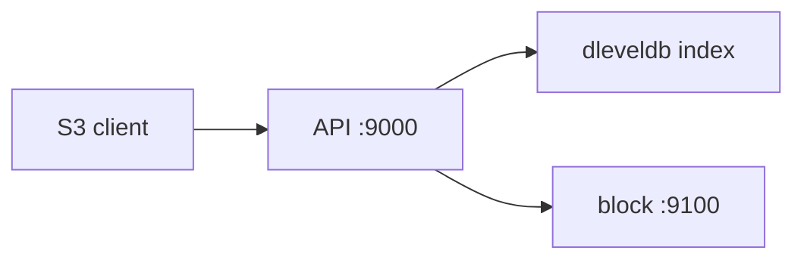

# s3dfs

**English** | [中文](README.zh-CN.md)

S3-compatible object storage. The control plane is TypeScript (Nest.js / Next.js). The on-disk engine is C. The index and the object body scale separately. The layout is aimed at large numbers of small objects.

| | |
| --- | --- |
| Index | A standalone [dleveldb](https://github.com/zhangxinlong633/dleveldb) cluster, usually 3–5 machines |
| Body | Block machines that only run the packed-block engine |
| Replicas | 3 by default. A majority is enough to acknowledge the write; repair fills the rest |
| Primary path | The S3 API. A directory mount is a compatibility layer and is not a performance path |

Objects are packed into ~1 GiB `.blk` files, batched in memory, then written with a group `write` + `fsync`. Inode and IOPS cost follow the number of data files. Placement lives in dleveldb locators. The control plane compresses with zstd by default and stores the original bytes, with `compressType=none`, when compression does not shrink the value.

## Documents

Design documents are in Chinese.

| Document | Reader | Question |
| --- | --- | --- |
| [Architecture](docs/architecture.md) | Someone tracing process boundaries | What the console, API, index, block nodes, and engine each own |
| [Capabilities](docs/capabilities.md) | Someone integrating or configuring | S3 operations and environment variables |
| [Deploy](docs/deploy.md) | Someone planning machines | Roles, replicas, and the public entry |
| [Launch criteria](docs/diff/production.md) | Someone deciding whether a cluster may hold the only copy | Acceptance tests and the on-cluster drill |
| [Recovery](docs/design-recovery.md) | Someone judging failure impact | Which requests continue |
| [Benchmarks](docs/benchmarks.md) | Someone citing numbers | Full tables from the 2026-11-17 single-host run |
| [Todo](docs/todo.md) | Someone scheduling work | Items that are still open |

## One write



1. The control plane compresses the body according to `S3DFS_COMPRESS`.
2. The stored bytes are written to the selected live block nodes. The default is 3 copies, and a majority is enough to continue.
3. Each successful block write returns a `recId`. The API publishes locators at `bucket/key`, `bucket/key:1`, and so on. If any index write fails, the locators published for that object are removed.
4. A read loads the locators, skips down nodes, fetches by `recId`, and decompresses with the type stored on the locator.

## Repository

Install and compile with pnpm 9+ and Node.js 26+. Node processes run on Bun 1.4+. The Nest API is compiled with `tsc`, then started with bun.

```text
apps/api         Nest.js 12 S3 API, default :9000
apps/web         Next.js 16 console, default :9001
apps/block       packed-block node, default :9100
packages/engine  C engine and N-API binding
packages/control index client, placement, health checks
docs/            product and design documents
```

The in-tree `packages/dleveldb` directory is historical and is not part of the build. Run the sibling dleveldb repository as the index.

## Start

Requires Node 26, pnpm 9, Bun 1.4+, Python 3, a C/C++ compiler, and a dleveldb checkout at `../dleveldb`.

```bash
git clone https://github.com/zhangxinlong633/dleveldb.git
git clone https://github.com/zhangxinlong633/s3dfs.git
cd s3dfs
pnpm install
pnpm build:engine
pnpm build:control
pnpm dev:index
pnpm dev:block
pnpm dev:api
pnpm dev:web
```

`pnpm dev:api` sets one replica and turns strict layout off, for a single machine. Production layout is in [Deploy](docs/deploy.md).

## Connect with the AWS CLI

Point the official AWS CLI at the Nest API (`:9000`) with `--endpoint-url`. No custom client is required. Use path-style addressing: `http://host:port/bucket/key`.

Local `pnpm dev:api` leaves the port open. A production process requires the same access key and secret on the API and on the CLI.

```bash
aws configure set default.s3.addressing_style path
export AWS_ACCESS_KEY_ID=your-access-key
export AWS_SECRET_ACCESS_KEY=your-secret-key
export AWS_DEFAULT_REGION=us-east-1

aws --endpoint-url http://127.0.0.1:9000 s3 mb s3://logs
aws --endpoint-url http://127.0.0.1:9000 s3 cp ./a.log s3://logs/a.log
aws --endpoint-url http://127.0.0.1:9000 s3 ls s3://logs
aws --endpoint-url http://127.0.0.1:9000 s3 cp s3://logs/a.log ./a.log
```

| Topic | Contract |
| --- | --- |
| Signature | SigV4. With both keys set, an unsigned request is 403 |
| Large objects | The CLI uses multipart or `aws-chunked`. The Nest API checks chunk signatures. Part bytes live in the block store and survive an API restart |
| ETag | CRC32, advertised as `x-s3dfs-etag-algorithm: crc32`. Do not treat the ETag as MD5. Use `Content-MD5` to check the body |
| Virtual host | With `S3DFS_DOMAIN`, the bucket is read from `bucket.domain`. DNS must point that name at the API |
| TLS | Terminate TLS at the reverse proxy and point `--endpoint-url` at the `https://` address |
| C gateway | The same path style and keys work. It is not the default entry: its multipart state is in memory and is lost on restart |

`aws s3api` and `aws s3` share this API, including create-bucket, upload, download, Range, copy, delete, and delete of an empty bucket.

## Single-host reference

Measured on 17 Nov 2026 on one MacBook Pro (Apple M5 Pro, 48 GB), over localhost. These figures describe the shape of the system. They are not a capacity commitment. Full tables are in [Benchmarks](docs/benchmarks.md).

| Planning case | Write | Read |
| --- | ---: | ---: |
| 1 KiB, N=1, sequential | 6,937 ops/s | 8,869 ops/s |
| 1 KiB, N=1, 32 in flight | 31,119 ops/s | 51,859 ops/s |
| 1 KiB, N=3, sequential | 2,785 ops/s | 4,151 ops/s |
| 1 MiB, N=1, incompressible | 208 ops/s | 409 ops/s |

That N=3 run had all three block processes up, so all three copies were written. Current code publishes after a majority and does not wait for the slowest copy.

## Boundary

Provided today: Put / Get / Head / Delete / List, Range, copy, presign, conditional requests, user metadata, multi-object delete, one bucket policy, one-key AES256, versioning, lifecycle, webhooks, multipart with part bytes in the block store, majority writes, failure domains, replica repair, and a health check that returns 503 after `lost`.

Not provided: a bounded buffer on a single Put, capacity numbers from the target cluster, erasure coding, site replication, Object Lock, quotas, audit logs, multi-user IAM, and KMS. See [Todo](docs/todo.md).

## Runtime

Bun 1.4+, Node.js 26, pnpm 9.15, TypeScript 7.0.2, NestJS 12.5.0, Next.js 16.4.6, React 19.3.1. The object index is [dleveldb](https://github.com/zhangxinlong633/dleveldb).
