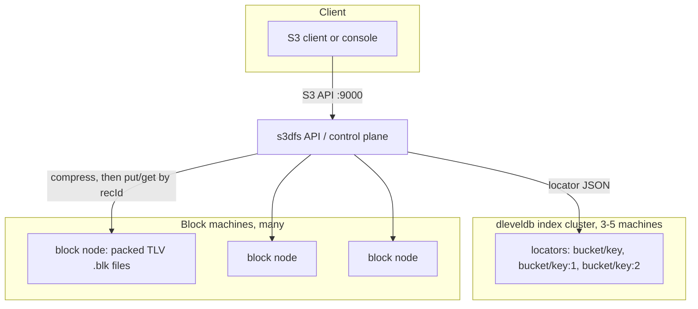

# s3dfs

**English** | [中文](README.zh-CN.md)

S3-compatible object store. The S3 API and console are TypeScript (Nest.js / Next.js). The on-disk engine is C.

The object index and the object body scale independently:

- Object keys and locators live in a standalone [dleveldb](https://github.com/zhangxinlong633/dleveldb) cluster. A small index cluster, about **3–5 machines**, is usually enough.
- Object bodies live on many **block machines** that only run the packed-block engine.
- The default is 3 data replicas, recorded in the index as `bucket/key`, `bucket/key:1`, and `bucket/key:2`, with node information in the values. The API periodically checks whether those nodes are still up, skips down nodes on get and put, and can still read from the remaining replicas.

The layout is aimed at small objects: there is no per-object directory. Objects are packed into large block files, batched in memory, then written with a group `write` + `fsync`. Inode and IOPS cost follow the number of data files, not the number of objects. Block records are checksummed TLV frames. All object placement is in dleveldb. The control plane compresses the body before writing (zstd by default). Each object’s type is stored on its locator as `compressType`. If compression does not shrink the value, the body is stored as-is and the type is recorded as `none`.

## What this repository does

- Objects are appended into large files (1 GiB per block by default). An object that does not fit in the current block is split into extents; the next extent records the previous extent’s `recId`, and a new file is opened when a block fills up.
- Each record is a little-endian TLV frame with magic `S3R1`, a CRC-32, and a matching trailer, so the file can be scanned and checked.
- A 1 MiB write buffer does group commit: many objects share one flush. Flush fsyncs by default.
- The control plane writes node information plus a stable `recId` into a dleveldb locator (`v: 3`). The block process keeps an in-memory map from `recId` to the file offset, rebuilt by scanning `.blk` files, and does not keep a local LevelDB.
- If the index is lost, locators can be rebuilt by scanning TLV records. Deletes append a tombstone and issue a cleanup ticket so a rebuild does not resurrect a deleted object. A timer or a manual compact then rewrites live records (keeping the same `recId`) and reclaims holes, without updating the index.

## Repository layout

This is a pnpm monorepo. Install and compile with **pnpm 9+** (requires **Node.js 26+**). Node processes run on **Bun 1.4+**. The Nest API is compiled with `tsc` first (decorator metadata is required) and then started with bun. The console is Next.js.

```
s3dfs/
  apps/api            # Nest.js 12 S3-compatible HTTP gateway (default :9000); a client of dleveldb and of block nodes
  apps/web            # Next.js 16 console (default :9001)
  apps/block          # packed-block storage node (default :9100+)
  packages/engine     # C storage engine + N-API binding (append-only TLV block files, recId map)
  packages/control    # index client, locators, compression, node registry, placement, and health checks
  docs/               # architecture, design, and benchmark notes
```

Run a sibling [dleveldb](https://github.com/zhangxinlong633/dleveldb) checkout as the object index (`pnpm dev:index` defaults to :9800). The in-tree `packages/dleveldb` directory is a historical pointer only and is not part of the build.

Layering and the read/write path are in [docs/architecture.md](docs/architecture.md). Placement and health checks are in [docs/design-replication.md](docs/design-replication.md). Large objects are in [docs/design-large-object.md](docs/design-large-object.md). Deletion holes and compaction (virtual record IDs, deferred cleanup) are in [docs/design-compaction.md](docs/design-compaction.md). Environment variables are in [docs/capabilities.md](docs/capabilities.md). Those design docs are currently in Chinese. Benchmark methodology and the full tables are in [docs/benchmarks.md](docs/benchmarks.md).

## Architecture overview



A write looks like this:

1. The control plane may compress the body (`S3DFS_COMPRESS`, default `zstd`). If the result is not smaller, it stores the original bytes and sets `compressType` to `none`.
2. The same stored bytes are written to N live block nodes (`N = min(configured replicas, live block nodes)`, default 3).
3. Each successful write returns an extent `recId`. The API writes locator JSON into dleveldb as `bucket/key`, `bucket/key:1`, and so on. User-facing `size` and `crc` are the uncompressed values; `storedSize` and `compressType` describe what is on disk.
4. A read looks up the locators, skips nodes that are down, fetches by `recId`, and decompresses with the type on that locator.

## Quick start

You need Node 26, pnpm 9, Bun 1.4+, Python 3, and a C/C++ compiler (Xcode Command Line Tools on macOS), plus a [dleveldb](https://github.com/zhangxinlong633/dleveldb) checkout next to this repository (default `../dleveldb`).

```bash
git clone https://github.com/zhangxinlong633/dleveldb.git
git clone https://github.com/zhangxinlong633/s3dfs.git
cd s3dfs
pnpm install
pnpm build:engine
pnpm build:control
pnpm dev:index    # dleveldb index, http://127.0.0.1:9800
pnpm dev:block    # block node,     http://127.0.0.1:9100
pnpm dev:api      # S3 API,         http://127.0.0.1:9000
pnpm dev:web      # console,        http://127.0.0.1:9001
```

On a single machine the effective data-replica count is 1. To see multiple replicas, start more block processes (different `S3DFS_BLOCK_NODE_ID`, `S3DFS_BLOCK_PORT`, and `S3DFS_DATA_DIR`) and list them in the API’s `S3DFS_BLOCK_NODES`. For a 3-replica index, start two more dleveldb nodes as in the dleveldb docs and point `S3DFS_INDEX_URLS` at them. Storage capacity still grows by adding block machines.

Data directories are gitignored. Environment variables are in [docs/capabilities.md](docs/capabilities.md).

```bash
aws --endpoint-url http://127.0.0.1:9000 s3 mb s3://logs
aws --endpoint-url http://127.0.0.1:9000 s3 cp ./a.log s3://logs/a.log
```

```bash
# tests (build the native addon first, on a machine that can compile C++)
pnpm --filter @s3dfs/engine build
pnpm --filter @s3dfs/control build
node packages/engine/scripts/test-span.mjs
bun scripts/test-split.mjs
```

## Performance

Numbers below were measured on 17 Nov 2026, 00:40 (Asia/Shanghai) with Bun 1.4.2 (node-compat v26.3.0), on a MacBook Pro (Apple M5 Pro, 15 cores, 48 GB, Apple SSD AP1024Z). They describe the current tree, including `recId` locators and idle compaction. Background compact was disabled for this run (`S3DFS_COMPACT_INTERVAL_MS=0`) so cleanup would not mix into the rates. They are single-host results, not a multi-machine network test. N is the object-body replica count: N=1 is one dleveldb process plus one block process; N=3 is one index plus three block processes on the same machine. Bandwidth is **logical** MiB/s (uncompressed object size / time, 1 MiB = 1,048,576 bytes). Compression ratio is logical size / stored size. The repeated payload is `0x61` bytes, a best-case pattern; the random payload is cryptographically random and typically does not shrink. When compression does not help, the locator records `compressType=none`. Reproduce with `pnpm bench` or `bun scripts/bench-split.mjs`. Methodology, raw JSON, and the same tables are in [docs/benchmarks.md](docs/benchmarks.md).


### Guidance for evaluators

These figures are a starting reference for people choosing a packed-block, S3-compatible store, not a service-level target. They come from one localhost run on one MacBook Pro. Absolute numbers will change on other hardware or across a real network. For product comparison, use the cluster path (API + index + block), not the direct-block row: that is what an S3 client actually sees.

There is no single “average ops/s” across the tables below. The rows mix object sizes, replica counts, sequential and pipelined requests, and a synthetic best-case compress path. On this machine, the useful planning figures are:

| Planning case | Write | Read | What it represents |
| --- | ---: | ---: | --- |
| 1 KiB, N=1, sequential, `none` | 6,937 ops/s, 6.8 MiB/s | 8,869 ops/s, 8.7 MiB/s | Typical single-copy baseline on this host |
| 1 KiB, N=1, 32 in flight, `none` | 31,119 ops/s, 30.4 MiB/s | 51,859 ops/s, 50.6 MiB/s | Concurrent small-object peak on this host |
| 1 KiB, N=3, sequential, `none` | 2,785 ops/s, 2.7 MiB/s | 4,151 ops/s, 4.1 MiB/s | Closer to the default three-copy write |
| 16 KiB, N=1, sequential, `none` | 4,664 ops/s, 72.9 MiB/s | 6,349 ops/s, 99.2 MiB/s | When bandwidth starts to matter |
| 1 MiB, N=1, incompressible | 208 ops/s, 208.2 MiB/s | 409 ops/s, 409.3 MiB/s | Large-object rate when compression cannot help |

On the 1 KiB, N=1 sequential path, put p50 / p99 was 137 µs / 221 µs, and get was 109 µs / 171 µs. Small objects are limited by HTTP and the index, not by disk bandwidth: a 100 B put (6,985 ops/s) is almost the same as a 1 KiB put (6,937 ops/s). Use ops/s when planning for many small objects, and MiB/s when objects are larger.

Default production writes make three object-body copies. In this localhost test, that cut 1 KiB sequential write throughput from 6,937 ops/s to 2,785 ops/s. A multi-machine deployment will add network cost on top, which is not in these numbers. Pipelining helps: 32 in-flight 1 KiB puts reached 11,196 ops/s at N=3.

Compression is zstd by default and is recorded per object. It helps most on logs and other repetitive text. The repeated `0x61` payload in the tables is a best case; the 1 MiB logical write rate of 2,423 MiB/s is not a disk-bandwidth number. Already-compressed or random data does not shrink; this run stored those objects as `none`, and the 1 KiB / 1 MiB rates stayed close to the uncompressed baseline (6,624 vs 6,750 ops/s at 1 KiB; 208 vs 224 ops/s at 1 MiB). On 1 KiB objects, even a 53.89× shrink barely moves ops/s, because the index and HTTP still dominate.

The layout is meant for a large number of small objects. 5,000 × 1 KiB objects landed in one `.blk` file, with 6 group fsyncs when uncompressed and 1 fsync after zstd shrank the payload. Each record now carries a 14-byte `recId` tag, so the uncompressed layout is 5,533,890 bytes (on-disk ratio 0.93x). There is no per-object directory and no local LevelDB on the block node. Compared with the 16 Nov 2026, 12:33 (Asia/Shanghai) TLV run on the same machine, before `recId` and compaction, the 1 KiB cluster hot path stayed within a few percent; this suite did not measure compact throughput. If you need a planning number, start from the table above, then run `pnpm bench` on your hardware with a sample of your own objects. Fuller notes and the earlier tables are in [docs/benchmarks.md](docs/benchmarks.md).

HTTP path, `compress=none` (so these rows are not mixed with the default zstd path):

| Workload | Throughput | Bandwidth | p50 | p99 |
| --- | ---: | ---: | ---: | ---: |
| direct block put 1 KiB (no index) | 18,619 ops/s | 18.2 MiB/s | 49 µs | 99 µs |
| direct block get 1 KiB (no index) | 19,361 ops/s | 18.9 MiB/s | 50 µs | 72 µs |
| cluster put 100 B, N=1 | 6,985 ops/s | 0.7 MiB/s | 135 µs | 247 µs |
| cluster get 100 B, N=1 | 8,965 ops/s | 0.9 MiB/s | 107 µs | 178 µs |
| cluster put 1 KiB, N=1 | 6,937 ops/s | 6.8 MiB/s | 137 µs | 221 µs |
| cluster get 1 KiB, N=1 | 8,869 ops/s | 8.7 MiB/s | 109 µs | 171 µs |
| cluster put 16 KiB, N=1 | 4,664 ops/s | 72.9 MiB/s | 198 µs | 618 µs |
| cluster get 16 KiB, N=1 | 6,349 ops/s | 99.2 MiB/s | 143 µs | 482 µs |
| cluster put 1 KiB, N=1, 32 in flight | 31,119 ops/s | 30.4 MiB/s | 914 µs | 3,518 µs |
| cluster get 1 KiB, N=1, 32 in flight | 51,859 ops/s | 50.6 MiB/s | 548 µs | 1,700 µs |
| cluster put 1 KiB, N=3 | 2,785 ops/s | 2.7 MiB/s | 337 µs | 760 µs |
| cluster get 1 KiB, N=3 | 4,151 ops/s | 4.1 MiB/s | 232 µs | 396 µs |
| cluster put 1 KiB, N=3, 32 in flight | 11,196 ops/s | 10.9 MiB/s | 2,730 µs | 4,854 µs |

A cluster put writes the block first, then the locator in dleveldb. At N=3 the put must succeed on three block processes, so it is slower than N=1. These numbers should not be compared with the in-process KV benches in the dleveldb repository: that path is pure KV, this one is HTTP index + block.

End-to-end cluster, N=1, including compression. Logical write rate rises on highly compressible objects because far fewer bytes go to disk; it is not a disk-bandwidth number.

| Workload | Stored type | Stored / logical | Ratio | Write | Read |
| --- | --- | ---: | ---: | ---: | ---: |
| 1 KiB repeated, none | none | 1,024 / 1,024 B | 1.00x | 6,750 ops/s, 6.6 MiB/s | 8,762 ops/s, 8.6 MiB/s |
| 1 KiB repeated, zstd | zstd | 19 / 1,024 B | 53.89x | 6,611 ops/s, 6.5 MiB/s | 8,416 ops/s, 8.2 MiB/s |
| 1 KiB repeated, gzip | gzip | 30 / 1,024 B | 34.13x | 6,747 ops/s, 6.6 MiB/s | 8,506 ops/s, 8.3 MiB/s |
| 1 KiB random, zstd | none | 1,024 / 1,024 B | 1.00x | 6,624 ops/s, 6.5 MiB/s | 8,785 ops/s, 8.6 MiB/s |
| 16 KiB repeated, none | none | 16,384 / 16,384 B | 1.00x | 4,455 ops/s, 69.6 MiB/s | 6,607 ops/s, 103.2 MiB/s |
| 16 KiB repeated, zstd | zstd | 19 / 16,384 B | 862.32x | 6,754 ops/s, 105.5 MiB/s | 7,990 ops/s, 124.8 MiB/s |
| 16 KiB random, zstd | none | 16,384 / 16,384 B | 1.00x | 4,298 ops/s, 67.2 MiB/s | 6,660 ops/s, 104.1 MiB/s |
| 1 MiB repeated, none | none | 1,048,576 / 1,048,576 B | 1.00x | 224 ops/s, 224.1 MiB/s | 400 ops/s, 400.2 MiB/s |
| 1 MiB repeated, zstd | zstd | 50 / 1,048,576 B | 20,971.52x | 2,423 ops/s, 2,422.8 MiB/s | 2,202 ops/s, 2,202.4 MiB/s |
| 1 MiB random, zstd | none | 1,048,576 / 1,048,576 B | 1.00x | 208 ops/s, 208.2 MiB/s | 409 ops/s, 409.3 MiB/s |

In-process codec only (no disk, no HTTP). Decompress is omitted when the type falls back to `none`, because that path is a no-op.

| Workload | Applied | Stored / logical | Ratio | Compress | Decompress |
| --- | --- | ---: | ---: | ---: | ---: |
| 1 MiB repeated, zstd | zstd | 50 / 1,048,576 B | 20,971.52x | 8,863 MiB/s | 5,271 MiB/s |
| 1 MiB repeated, gzip | gzip | 1,052 / 1,048,576 B | 996.75x | 4,081 MiB/s | 4,032 MiB/s |
| 1 MiB random, zstd | none | 1,048,576 / 1,048,576 B | 1.00x | 3,662 MiB/s | — |
| 1 MiB random, gzip | none | 1,048,576 / 1,048,576 B | 1.00x | 101 MiB/s | — |
| 16 KiB repeated, zstd | zstd | 19 / 16,384 B | 862.32x | 3,567 MiB/s | 2,241 MiB/s |

On-disk layout, 5,000 × 1 KiB objects written directly through the C engine and flushed. There is no `index/` directory.

| Case | Files | On disk | Logical | On-disk ratio | fsyncs |
| --- | ---: | ---: | ---: | ---: | ---: |
| raw repeated (no compression) | 1 × `.blk` | 5,533,890 B | 5,120,000 B | 0.93x | 6 |
| zstd repeated (19 B payload each) | 1 × `.blk` | 508,890 B | 5,120,000 B | 10.06x | 1 |
| zstd random (fell back to `none`) | 1 × `.blk` | 5,533,890 B | 5,120,000 B | 0.93x | 6 |

The zstd on-disk ratio is lower than the payload ratio (53.89x) because each record still carries TLV tags, including the 14-byte `recId` tag, lengths, and a CRC. Inode and file count follow the block file, not the object count.

## Implemented and not yet done

Already working: Put / Get / Head / Delete / List, create bucket, a split index and block deployment, default 3 object-body replicas, reads from remaining replicas after a block copy is down, per-object compression, TLV records, `recId` locators, locator rebuild by scan, tombstones on delete, and idle or manual compaction that reclaims deleted space without updating the index.

Not done yet: multipart upload, full SigV4, erasure coding, automatic repair or migration of object replicas, streaming, and the engine’s uint32 object-size limit. Join catch-up and primary write failover are also still unimplemented in dleveldb: a new index node does not pull historical keys, and if the index primary is unreachable, writes fail.

## Dependencies

Current major versions:

- Node runtime: Bun 1.4+
- Install and compile: Node.js 26, pnpm 9.15
- TypeScript 7.0.2
- NestJS 12.5.0
- Next.js 16.4.6, React 19.3.1
- Object index: [dleveldb](https://github.com/zhangxinlong633/dleveldb)
