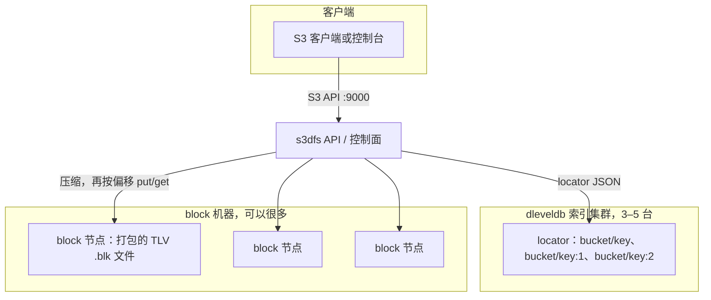

# s3dfs

[English](README.md) | **中文**

S3 兼容的对象存储。S3 API 和管控台用 TypeScript（Nest.js / Next.js），落盘引擎用 C。

对象索引和正文分开扩容：

- 分布式的对象 key / locator 放在独立的 [dleveldb](https://github.com/zhangxinlong633/dleveldb) 集群里，一般 **3–5 台**就够
- 对象正文放在大量只跑 packed-block 引擎的 **block 机器**上，机器可以很多
- 默认 3 份数据副本，在索引里记成 `bucket/key`、`bucket/key:1`、`bucket/key:2`，值里带上节点信息；API 会定期检查这些节点是否还活着，读写时跳过宕机节点，并可以从剩下的副本读取

设计上针对小文件：不会一个对象一个目录，而是把对象打进大的 block 文件，在内存里攒批后再 `write` + `fsync`。inode 和 IOPS 跟数据文件数走，而不是跟对象数走。block 记录是带校验的 TLV 帧，对象定位全部放在 dleveldb 里。写入前控制面默认用 zstd 压缩，每个对象自己的类型记在 locator 的 `compressType` 里；如果压缩没有变小，就按原文落盘，并把类型记成 `none`。

## 这个仓库做什么

- 对象追加进大文件（默认 1 GiB 一块，可配）。超过当前块的对象切成多段，后一段记下前一段的位置，写满再切新文件。
- 每条记录是小端 TLV 帧，带魔数 `S3R1`、CRC-32 和对称的尾部，方便扫描和校验。
- 1 MiB 写缓冲做 group commit，一批对象一次刷盘；flush 时默认 `fsync`。
- 控制面把节点信息和 `(blockId, offset, recLen)` 写进 dleveldb 的 locator；block 进程按偏移读写，不再维护本地 LevelDB。
- 索引丢了时可以扫描 TLV 记录重建 locator。删除会写墓碑，避免重建时把已删对象救回来。按存活对象重写 block、回收空洞的 compaction，**本轮还没有做**。

## 仓库结构

这是一个 pnpm monorepo。安装和编译用 **pnpm 9+**（需要 **Node.js 26+**）。节点进程跑在 **Bun 1.4+** 上。Nest API 要先用 `tsc` 编译（需要装饰器元数据），再用 bun 启动。控制台是 Next.js。

```
s3dfs/
  apps/api            # Nest.js 12，S3 兼容 HTTP 网关（默认 :9000），是 dleveldb 和 block 的客户端
  apps/web            # Next.js 16 控制台（默认 :9001）
  apps/block          # packed-block 存储节点（默认 :9100 起）
  packages/engine     # C 存储引擎 + N-API 绑定（追加式 TLV block 文件，按偏移读写）
  packages/control    # 索引客户端、locator、压缩、节点注册、放置与健康检查
  docs/               # 架构、设计和性能测试说明
```

对象索引请运行旁边的 [dleveldb](https://github.com/zhangxinlong633/dleveldb)（`pnpm dev:index` 默认 :9800）。本仓库里的 `packages/dleveldb` 只是历史对照，不再参与构建。

分层和读写路径见 [docs/architecture.md](docs/architecture.md)。放置与健康检查见 [docs/design-replication.md](docs/design-replication.md)。大对象见 [docs/design-large-object.md](docs/design-large-object.md)。环境变量见 [docs/capabilities.md](docs/capabilities.md)。这些设计文档目前是中文。方法和完整表格见 [docs/benchmarks.md](docs/benchmarks.md)。

## 架构概览



一次写入大致是这样：

1. 控制面可以按 `S3DFS_COMPRESS` 压缩正文（默认 `zstd`）。如果没有变小，就保存原文，并把 `compressType` 记成 `none`。
2. 同一份已存储字节写到 N 台存活的 block 节点上（`N = min(配置副本数, 当前存活的 block 数)`，默认 3）。
3. 每次成功写入会返回一段位置。API 把 locator JSON 写进 dleveldb，键是 `bucket/key`、`bucket/key:1` 等。对外的 `size` 和 `crc` 是未压缩值；`storedSize` 和 `compressType` 描述盘上实际内容。
4. 读取时先查 locator，跳过宕机节点，按偏移取数据，再用该 locator 上的类型解压。

## 快速开始

需要本机有 Node 26、pnpm 9、Bun 1.4+、Python 3 和 C/C++ 编译器（macOS 上是 Xcode Command Line Tools），以及旁边的 [dleveldb](https://github.com/zhangxinlong633/dleveldb) 仓库（默认 `../dleveldb`）。

```bash
git clone https://github.com/zhangxinlong633/dleveldb.git
git clone https://github.com/zhangxinlong633/s3dfs.git
cd s3dfs
pnpm install
pnpm build:engine
pnpm build:control
pnpm dev:index    # dleveldb 索引，http://127.0.0.1:9800
pnpm dev:block    # block 节点，    http://127.0.0.1:9100
pnpm dev:api      # S3 API，        http://127.0.0.1:9000
pnpm dev:web      # 控制台，        http://127.0.0.1:9001
```

单机时有效数据副本是 1。要看多副本，再起几台 block（不同的 `S3DFS_BLOCK_NODE_ID`、`S3DFS_BLOCK_PORT`、`S3DFS_DATA_DIR`），并在 API 的 `S3DFS_BLOCK_NODES` 里加上它们。索引集群若要 3 副本，按 dleveldb 的文档再起两台索引节点，把 `S3DFS_INDEX_URLS` 指过去即可；存储容量仍只靠加 block 机器。

数据目录已 gitignore。环境变量见 [docs/capabilities.md](docs/capabilities.md)。

```bash
aws --endpoint-url http://127.0.0.1:9000 s3 mb s3://logs
aws --endpoint-url http://127.0.0.1:9000 s3 cp ./a.log s3://logs/a.log
```

```bash
# 测试（原生插件需在能编译 C++ 的机器上先 build）
pnpm --filter @s3dfs/engine build
pnpm --filter @s3dfs/control build
node packages/engine/scripts/test-span.mjs
bun scripts/test-split.mjs
```

## 性能

下面的数字是 2026-11-16 12:33（Asia/Shanghai）在一台 MacBook Pro（Apple M5 Pro，15 核，48 GB，Apple SSD AP1024Z）上用 Bun 1.4.2（node-compat v26.3.0）测到的。都是单机结果，不是多机网络环境。N 是对象正文副本数：N=1 是一台 dleveldb 加一台 block；N=3 是同一台机器上的一台索引加三台 block。带宽是**逻辑** MiB/s（未压缩对象大小 / 时间，1 MiB = 1,048,576 字节）。压缩比是逻辑大小 / 存储大小。重复内容是全部 `0x61` 的字节，属于最好情况；随机内容是密码学随机数，通常压不小。压不小的时候，locator 会记 `compressType=none`。可以用 `pnpm bench` 或 `bun scripts/bench-split.mjs` 复现。方法和同一张表见 [docs/benchmarks.md](docs/benchmarks.md)。

HTTP 路径，`compress=none`（避免和默认的 zstd 路径混在一起）：

| 负载 | 吞吐 | 带宽 | p50 | p99 |
| --- | ---: | ---: | ---: | ---: |
| direct block put 1 KiB（不经索引） | 18,716 ops/s | 18.3 MiB/s | 49 µs | 96 µs |
| direct block get 1 KiB（不经索引） | 19,334 ops/s | 18.9 MiB/s | 50 µs | 77 µs |
| cluster put 100 B，N=1 | 6,938 ops/s | 0.7 MiB/s | 137 µs | 231 µs |
| cluster get 100 B，N=1 | 8,816 ops/s | 0.8 MiB/s | 109 µs | 194 µs |
| cluster put 1 KiB，N=1 | 6,795 ops/s | 6.6 MiB/s | 138 µs | 341 µs |
| cluster get 1 KiB，N=1 | 8,708 ops/s | 8.5 MiB/s | 110 µs | 179 µs |
| cluster put 16 KiB，N=1 | 4,663 ops/s | 72.9 MiB/s | 199 µs | 566 µs |
| cluster get 16 KiB，N=1 | 6,507 ops/s | 101.7 MiB/s | 144 µs | 348 µs |
| cluster put 1 KiB，N=1，32 并发 | 31,157 ops/s | 30.4 MiB/s | 950 µs | 2,620 µs |
| cluster get 1 KiB，N=1，32 并发 | 49,001 ops/s | 47.9 MiB/s | 578 µs | 1,637 µs |
| cluster put 1 KiB，N=3 | 2,775 ops/s | 2.7 MiB/s | 337 µs | 760 µs |
| cluster get 1 KiB，N=3 | 4,119 ops/s | 4.0 MiB/s | 232 µs | 545 µs |
| cluster put 1 KiB，N=3，32 并发 | 11,225 ops/s | 11.0 MiB/s | 2,742 µs | 4,633 µs |

走索引的 put 会先写 block，再把 locator 写入 dleveldb。N=3 时 put 要在三台 block 上都写成功，所以比 N=1 慢。这些数字不要和 dleveldb 仓库里的进程内基准混比：那是纯 KV，这条路径是对象存储的 HTTP 索引 + block。

端到端集群，N=1，带压缩。高度可压缩对象的逻辑写入速率会更高，因为落盘字节少得多；这不是磁盘带宽。

| 负载 | 实际类型 | 存储 / 逻辑 | 压缩比 | 写入 | 读取 |
| --- | --- | ---: | ---: | ---: | ---: |
| 1 KiB 重复，none | none | 1,024 / 1,024 B | 1.00x | 6,716 ops/s，6.6 MiB/s | 8,823 ops/s，8.6 MiB/s |
| 1 KiB 重复，zstd | zstd | 19 / 1,024 B | 53.89x | 6,680 ops/s，6.5 MiB/s | 8,363 ops/s，8.2 MiB/s |
| 1 KiB 重复，gzip | gzip | 30 / 1,024 B | 34.13x | 6,682 ops/s，6.5 MiB/s | 8,520 ops/s，8.3 MiB/s |
| 1 KiB 随机，zstd | none | 1,024 / 1,024 B | 1.00x | 6,485 ops/s，6.3 MiB/s | 8,770 ops/s，8.6 MiB/s |
| 16 KiB 重复，none | none | 16,384 / 16,384 B | 1.00x | 4,747 ops/s，74.2 MiB/s | 6,600 ops/s，103.1 MiB/s |
| 16 KiB 重复，zstd | zstd | 19 / 16,384 B | 862.32x | 6,777 ops/s，105.9 MiB/s | 7,691 ops/s，120.2 MiB/s |
| 16 KiB 随机，zstd | none | 16,384 / 16,384 B | 1.00x | 4,423 ops/s，69.1 MiB/s | 6,678 ops/s，104.3 MiB/s |
| 1 MiB 重复，none | none | 1,048,576 / 1,048,576 B | 1.00x | 225 ops/s，225.2 MiB/s | 419 ops/s，419.1 MiB/s |
| 1 MiB 重复，zstd | zstd | 50 / 1,048,576 B | 20,971.52x | 2,319 ops/s，2,319.4 MiB/s | 2,159 ops/s，2,159.1 MiB/s |
| 1 MiB 随机，zstd | none | 1,048,576 / 1,048,576 B | 1.00x | 209 ops/s，208.5 MiB/s | 417 ops/s，416.9 MiB/s |

只测控制面编解码（不落盘、不走 HTTP）。当类型回退成 `none` 时，解压是空操作，所以不解压速度。

| 负载 | 实际类型 | 存储 / 逻辑 | 压缩比 | 压缩 | 解压 |
| --- | --- | ---: | ---: | ---: | ---: |
| 1 MiB 重复，zstd | zstd | 50 / 1,048,576 B | 20,971.52x | 8,414 MiB/s | 5,407 MiB/s |
| 1 MiB 重复，gzip | gzip | 1,052 / 1,048,576 B | 996.75x | 4,100 MiB/s | 4,059 MiB/s |
| 1 MiB 随机，zstd | none | 1,048,576 / 1,048,576 B | 1.00x | 3,589 MiB/s | — |
| 1 MiB 随机，gzip | none | 1,048,576 / 1,048,576 B | 1.00x | 98 MiB/s | — |
| 16 KiB 重复，zstd | zstd | 19 / 16,384 B | 862.32x | 3,522 MiB/s | 2,279 MiB/s |

落盘布局：直接通过 C 引擎顺序写入 5,000 个 1 KiB 对象并 `flush`。没有 `index/` 目录。

| 用例 | 文件 | 盘上占用 | 逻辑大小 | 盘上比 | fsync 次数 |
| --- | ---: | ---: | ---: | ---: | ---: |
| 原文重复（不压缩） | 1 个 `.blk` | 5,463,890 B | 5,120,000 B | 0.94x | 6 |
| zstd 重复（每条 payload 19 B） | 1 个 `.blk` | 438,890 B | 5,120,000 B | 11.67x | 1 |
| zstd 随机（回退为 `none`） | 1 个 `.blk` | 5,463,890 B | 5,120,000 B | 0.94x | 6 |

zstd 的盘上比低于 payload 比（53.89x），因为每条记录还带有 TLV 的 tag、长度和 CRC。inode 和文件数跟 block 文件走，而不是跟对象数走。

## 已经实现和还没有做的

已经可以：Put / Get / Head / Delete / List、创建桶、索引和 block 分开部署、默认 3 份对象正文副本、一份 block 副本宕机后从剩余副本读取、按对象压缩、TLV 记录、扫描重建 locator、删除写墓碑。

还没有做：分片上传、完整 SigV4、纠删码、block compaction / GC（删除不会回收空间）、对象副本的自动修复或迁移、流式读写，以及引擎的 uint32 对象大小上限。dleveldb 的加入迁移和 primary 写故障转移也还未实现：新索引节点不会自动拉历史 key；索引主节点不可达时，写入会失败。

## 依赖

当前使用的主要版本：

- 节点运行时：Bun 1.4+
- 安装与编译：Node.js 26、pnpm 9.15
- TypeScript 7.0.2
- NestJS 12.5.0
- Next.js 16.4.6、React 19.3.1
- 对象索引：[dleveldb](https://github.com/zhangxinlong633/dleveldb)
