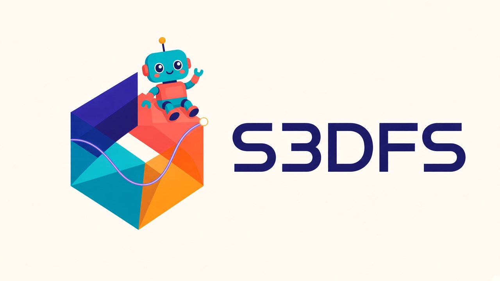
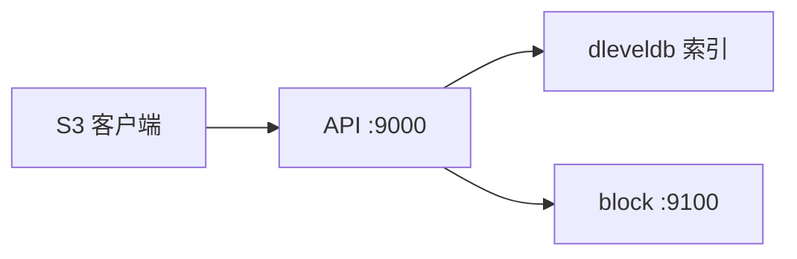

# S3DFS

[English](README.md) | **中文**



S3DFS 是 S3 兼容的对象存储。控制面是 TypeScript（Nest.js / Next.js），落盘引擎是 C。对象索引和对象正文分开扩容，面向大量小对象。仓库目录、命令和 `/_s3dfs/` 路径仍用小写。

索引放在独立的 [dleveldb](https://github.com/zhangxinlong633/dleveldb) 集群上，通常 3 到 5 台就够。正文放在只跑 packed-block 引擎的 block 机器上，机器按容量增加。默认保存 3 份副本，达到多数就对客户端成功，没写上的一份由修复补齐。日常入口是 S3 API。把一个桶挂成本地目录只是兼容层，挂载速度不代表存储性能。

对象打进约 1 GiB 的 `.blk`，在内存里攒批后再 `write` + `fsync`。inode 和 IOPS 跟数据文件数走，不跟对象数走。定位信息是 dleveldb 里的 locator。写入前默认用 zstd；压不小则按原文落盘，并把 `compressType` 记成 `none`。

系统自带巡检 AI，进程是 `apps/patrol`，不在写入路径上。它每天看索引、block、布局、修复、API、扩缩和告警。活副本不足、空洞过高、写缓冲未落盘，或负载持续高且已配置扩容脚本时，由规则直接做修复、compact、flush 或扩容。模型只把这些数字和已经执行的动作写成给值班人看的中文结论，不读对象正文，也不删除、重启或缩容。默认连本机 LM Studio 的 Gemma 4 26B。`S3DFS_PATROL_MODEL=off` 时仍做规则巡检。结论在 `GET /_s3dfs/decisions`，同时写成 `reports/` 下的 HTML。

## 功能

完整变量和行为见 [能力](docs/capabilities.md)。

| 功能 | 现在能做什么 |
| --- | --- |
| 索引与正文分离 | 索引在 dleveldb，正文在可扩展的 block 机器上 |
| 打包与压缩 | 对象追加进约 1 GiB 的 `.blk`。默认 zstd，压不小则存原文 |
| 副本与故障域 | 默认 3 份，多数成功即提交。`@zone` 把副本分到不同故障域。节点或故障域不够时拒绝写入 |
| 索引提交 | locator 逐条写入。任一条失败则删掉本次已经写下的 locator |
| 对象接口 | Put / Get / Head / Delete / List、单个 Range、拷贝、预签名、条件请求、用户元数据、批量删除 |
| 桶 | 建桶、删除空桶、JSON 桶策略、单密钥 AES256、版本与删除标记、生命周期、webhook |
| 分片 | 清单在索引，正文在 block。API 重启后分片仍在。ETag 为 CRC32 |
| 签名与 CLI | 两个密钥都在时校验 SigV4。官方 AWS CLI 用路径风格和 `--endpoint-url` 直连 |
| 健康与修复 | 活副本不足时补齐。没有任何活副本记为 `lost`，健康检查返回 503 |
| 空间与扩缩 | 删除后 compact 回收空洞。配置脚本后按容量和延迟扩缩索引、block 或 API |
| 控制台与挂载 | 控制台看统计、桶和节点。`s3dfs-fuse` 把一个桶挂成本地目录 |
| 自带巡检 AI | 规则执行修复、compact、flush 和已配置的扩容。简报含现状、相比上次、已执行和值班下一步，并写成 HTML。模型据此写中文结论 |

尚未提供：目标集群上的容量数字，以及纠删码、站点复制、Object Lock、配额、审计、多用户 IAM 和 KMS。超过 1 MiB 的原始 Put 已按块转发，`aws-chunked` 仍整段缓冲。清单见 [待办](docs/todo.md)。

## 文档

| 文档 | 给谁 | 回答什么 |
| --- | --- | --- |
| [架构](docs/architecture.md) | 需要看进程边界的人 | 控制台、API、索引、block、引擎各管什么 |
| [能力](docs/capabilities.md) | 对接接口和配置的人 | 已提供的 S3 能力与环境变量 |
| [部署](docs/deploy.md) | 规划机器和值班的人 | 角色、副本、入口，以及 systemd、Docker、Kubernetes 的例子 |
| [上线标准](docs/diff/production.md) | 决定能否承接业务数据的人 | 验收项和目标集群演练 |
| [规模说明](docs/scale.md) | 评估容量和排机器的人 | 100 EB 业务容量如何换成 block 与索引，以及 50 PB 磁盘的案例 |
| [故障与恢复](docs/design-recovery.md) | 评估故障影响的人 | 哪些请求还能继续 |
| [索引与 block](docs/design-replication.md) | 区分两套副本的人 | 放置、健康检查、法定人数 |
| [基准](docs/benchmarks.md) | 引用数字的人 | 按日期分篇，放在 `docs/benchmarks/` |
| [待办](docs/todo.md) | 排期的人 | 尚未关闭的事项 |
| [第一次巡检](docs/milestones/2026-11-20-first-patrol.md) | 想看系统第一次自己跑通的人 | 2026-11-20 从自启到本机模型结论 |

## 一次写入



1. 控制面按 `S3DFS_COMPRESS` 压缩正文。没有变小则保存原文。
2. 同一份已存储字节写到选出的存活 block 上。默认 3 份，达到多数即继续。
3. 每次成功写入返回 `recId`。API 把 locator 写入索引：`bucket/key`、`bucket/key:1` 等。任一条索引写入失败，则删除本次已写入的 locator。
4. 读取先查 locator，跳过宕机节点，按 `recId` 取数，再按该 locator 的类型解压。

## 仓库

安装和编译用 pnpm 9+、Node.js 26+。节点进程跑在 Bun 1.4+ 上。Nest API 先用 `tsc` 编译，再用 bun 启动。

```text
apps/api         Nest.js 12，S3 API，默认 :9000
apps/web         Next.js 16 控制台，默认 :9001
apps/block       packed-block 节点，默认 :9100
apps/patrol      巡检进程，TypeScript 的 Deep Agents
packages/engine  C 引擎与 N-API 绑定
packages/control 索引客户端、放置、健康检查
docs/            产品与设计文档
```

本仓库的 `packages/dleveldb` 只作历史对照，不参与构建。索引请运行旁边的 dleveldb。

## 开始使用

需要 Node 26、pnpm 9、Bun 1.4+、C/C++ 编译器，以及旁边的 dleveldb 仓库（默认 `../dleveldb`）。产品代码只有 TypeScript 和 C。编译引擎时 node-gyp 可能调用本机 Python，那不是产品语言。约束见 [架构](docs/architecture.md#语言)。

```bash
git clone https://github.com/zhangxinlong633/dleveldb.git
git clone https://github.com/zhangxinlong633/s3dfs.git
cd s3dfs
pnpm install
pnpm build:engine
pnpm build:control
pnpm dev:index    # http://127.0.0.1:9800
pnpm dev:block    # http://127.0.0.1:9100
pnpm dev:api      # http://127.0.0.1:9000
pnpm dev:web      # http://127.0.0.1:9001
S3DFS_PATROL_TOKEN=本机凭证 S3DFS_PATROL_INTERVAL_MS=0 pnpm patrol
```

`pnpm dev:api` 把副本设为 1 并关闭严格布局，供单机开发。巡检进程和 API 使用同一个 `S3DFS_PATROL_TOKEN`。生产部署见 [部署](docs/deploy.md)。第一次从自启到模型结论的记录见 [里程碑](docs/milestones/2026-11-20-first-patrol.md)。

发给机器的是 GitHub Release 上的 `s3dfs-<版本>-<系统>-<架构>.tar.gz`。压缩包里有 `使用说明.md`。开发时的 `pnpm dev` 仍从各包目录启动。

## 用压缩包运行

从标签页下载和这台机器系统一致的包，解压到 `/opt/s3dfs`。索引要另外准备好。数据在 `/var/lib/s3dfs`，换版本不要删。下面是一台机器、一份副本的启动。多台机器、systemd、Docker 和 Kubernetes 见 [部署](docs/deploy.md) 第 8 节。

```bash
sudo mkdir -p /opt/s3dfs /var/lib/s3dfs/block/block1
sudo tar -C /opt/s3dfs -xzf s3dfs-0.1.1-linux-x64.tar.gz
cd /opt/s3dfs
export S3DFS_INDEX_URLS=http://127.0.0.1:9800
export S3DFS_DATA_REPLICAS=1
export S3DFS_STRICT_LAYOUT=0
S3DFS_BLOCK_NODE_ID=block1 S3DFS_DATA_DIR=/var/lib/s3dfs/block/block1 S3DFS_ADVERTISE_ADDR=127.0.0.1:9100 bun block/main.js
```

另一个终端启动接口，然后看健康检查：

```bash
cd /opt/s3dfs
export S3DFS_INDEX_URLS=http://127.0.0.1:9800
export S3DFS_BLOCK_NODES=block1=127.0.0.1:9100
export S3DFS_DATA_REPLICAS=1
export S3DFS_STRICT_LAYOUT=0
bun api/main.js
curl -fsS http://127.0.0.1:9000/_s3dfs/health
```

正式环境把 `S3DFS_STRICT_LAYOUT` 保持开启，并设置 `S3DFS_ACCESS_KEY` 和 `S3DFS_SECRET_KEY`。巡检是 `bun patrol/main.js`，控制台是 `npm run start:web`。

## 用 AWS CLI 接入

默认入口是 Nest API（`:9000`）。官方 AWS CLI 把 `--endpoint-url` 指过来即可，不需要专用客户端。寻址用路径风格：`http://主机:端口/桶/对象`。

本机开发未配置密钥（`pnpm dev:api` 会关闭严格布局）。生产必须在 API 和 CLI 上配置同一对密钥。

```bash
aws configure set default.s3.addressing_style path
export AWS_ACCESS_KEY_ID=你的访问密钥
export AWS_SECRET_ACCESS_KEY=你的秘密密钥
export AWS_DEFAULT_REGION=us-east-1

aws --endpoint-url http://127.0.0.1:9000 s3 mb s3://logs
aws --endpoint-url http://127.0.0.1:9000 s3 cp ./a.log s3://logs/a.log
aws --endpoint-url http://127.0.0.1:9000 s3 ls s3://logs
aws --endpoint-url http://127.0.0.1:9000 s3 cp s3://logs/a.log ./a.log
```

| 事项 | 约定 |
| --- | --- |
| 签名 | SigV4。两个密钥都配置后，无签名请求返回 403 |
| 大对象 | CLI 会走分片或 `aws-chunked`。Nest API 校验分块签名，分片正文在 block 中，进程重启后仍在 |
| ETag | CRC32，响应头 `x-s3dfs-etag-algorithm: crc32`。不要把 ETag 当成 MD5。校验正文用 `Content-MD5` |
| 虚拟主机 | 设置 `S3DFS_DOMAIN` 后，`桶.域名` 由 Host 解析。DNS 须把该名字指到 API |
| TLS | 在反向代理上终止。CLI 的 `--endpoint-url` 改为 `https://` 入口 |
| C 网关 | 同一套路径风格和密钥可以连上，但不是默认入口。它的分片在进程内存里，重启即丢失 |

`aws s3api` 与 `aws s3` 走同一套接口，包括建桶、上传、下载、Range、拷贝、删除和删除空桶。

```bash
pnpm --filter @s3dfs/engine build
pnpm --filter @s3dfs/control build
node packages/engine/scripts/test-span.mjs
bun scripts/test-split.mjs
```

## 本机参考

测量日期 2026-11-17，一台 MacBook Pro（Apple M5 Pro，48 GB），localhost。这是选型时的形状，不是容量承诺。完整表格、延迟和压缩比见 [基准](docs/benchmarks.md)。

| 规划场景 | 写入 | 读取 |
| --- | ---: | ---: |
| 1 KiB，N=1，串行 | 6,937 ops/s | 8,869 ops/s |
| 1 KiB，N=1，32 并发 | 31,119 ops/s | 51,859 ops/s |
| 1 KiB，N=3，串行 | 2,785 ops/s | 4,151 ops/s |
| 1 MiB，N=1，不可压缩 | 208 ops/s | 409 ops/s |

当时 N=3 的三台 block 都在线，三份都会写完。当前代码在多数成功后即提交，不再等待最慢的一份。

## 运行环境

Bun 1.4+、Node.js 26、pnpm 9.15、TypeScript 7.0.2、NestJS 12.5.0、Next.js 16.4.6、React 19.3.1。对象索引为 [dleveldb](https://github.com/zhangxinlong633/dleveldb)。
