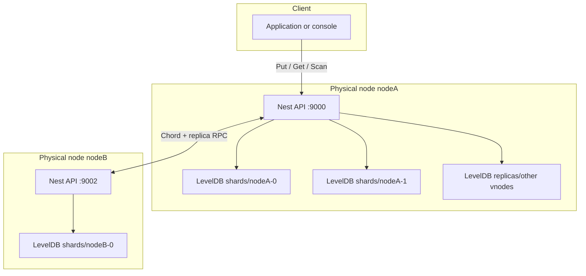

# dleveldb

**English** | [中文](README.zh-CN.md)

Distributed LevelDB. This repository is a **standard distributed KV store**: each machine can run several LevelDB shards, machines are joined with a Chord ring, keys are located by hash, and the default replication factor is 3.

Values are stored inside LevelDB itself. This is not a packed-block engine and not an object store. A system that packs small files into large blocks (for example s3dfs) should keep that layer itself and use dleveldb only as an index or general-purpose KV.

## What this repository does

Standalone LevelDB is reliable, but it holds a single copy and has no cross-machine routing. dleveldb adds three things on top:

1. **Sharding.** One machine can run several virtual nodes. Each vnode is a directory named `{nodeId}-{seq}` and is a separate, standard LevelDB.
2. **Placement.** A Chord DHT places every vnode on a 160-bit ring. Puts and gets hash the key with SHA-1 and look up the successor, so they do not broadcast to the whole cluster.
3. **Replication.** A key is stored on 3 different physical machines by default. The write quorum W defaults to a majority. On a single machine the effective replica count becomes 1, so behavior matches local LevelDB.

The API is ordinary KV: `Put`, `Get`, `Delete`, and prefix scan. Object-storage clients, including the AWS CLI, do not connect here. They connect to an s3dfs API that uses this store as its index.

## Documents

| Document | Question |
| --- | --- |
| [Architecture](docs/architecture.md) | Process boundaries, the read/write path, and what survives one down machine. In Chinese |
| [Design](docs/design.md) | Placement, on-disk format, and HTTP RPC. In Chinese |
| [Benchmarks](docs/benchmarks.md) | The 16 Nov 2026 single-host measurements |

## Repository layout

This is a pnpm monorepo. Install and compile with **pnpm 9+** (requires **Node.js 26+**). **Node processes run on Bun 1.4+**. The core library can execute TypeScript directly; the Nest API is compiled with `tsc` first (decorator metadata is required) and then started with bun. The console is still Next.js.

```
dleveldb/
  packages/dleveldb   # standalone core library (npm package name: dleveldb)
  apps/api            # NestJS 12 node process, HTTP RPC
  apps/web            # Next.js 16 console for cluster status and KV operations
  docs/               # architecture, design, and benchmark notes
```

| Package | Role |
| --- | --- |
| `packages/dleveldb` | Core: local LevelDB, Chord, replicas, HTTP RPC |
| `apps/api` | Embeds the core library in Nest, listens on a port, serves other nodes and the console |
| `apps/web` | Browser console: cluster status, Get / Put / Delete, prefix scan |

Layering, read/write paths, and failure semantics are in [docs/architecture.md](docs/architecture.md). Placement rules and the RPC list are in [docs/design.md](docs/design.md). Those two design docs are currently in Chinese.

## Architecture overview



A write looks like this:

1. Compute `SHA-1(utf8(key))` and find the successor vnode on the ring. That vnode is the **primary**.
2. If the primary is not local, the request is forwarded to that node.
3. The primary writes the value into its own LevelDB, then copies it to the other machines on the preference list (at most two more, by default).
4. The Put succeeds only after the write quorum (majority by default) has acknowledged it.
5. If the primary process is unreachable, the first live node on the preference list accepts the write onto a majority of the remaining copies. A restarted primary copies newer keys back from those copies. Two partitions that both contain a quorum are still not allowed: a write needs W live copies from the preference list.

Reads search every local primary shard and every local replica store first, then ask other nodes. After the primary dies, surviving replicas can still serve reads.

Prefix scan is **scatter-gather**: keys are placed by hash, so a prefix is usually not a single LevelDB seek (the exception is a single machine with a single vnode and no peers).

## Quick start

Install and build:

```bash
git clone https://github.com/zhangxinlong633/dleveldb.git
cd dleveldb
pnpm install
pnpm build
pnpm test
```

Use it as a library:

```ts
import { DLevelDB, loadConfig } from 'dleveldb';

const db = await DLevelDB.open(loadConfig({}, {
  dataDir: './data',
  nodeId: 'node1',
  advertiseAddr: '127.0.0.1:9000',
  vnodeCount: 4,
  replicas: 3,
}));

await db.put('logs/2026/a.log', Buffer.from('hello'));
const got = await db.get('logs/2026/a.log');
const listed = await db.scan({ prefix: 'logs/2026/', maxKeys: 100 });
await db.close();
```

Start a node with the console (the API runs on Bun):

```bash
pnpm dev:api    # tsc watch + bun --watch, http://127.0.0.1:9000
pnpm dev:web    # http://127.0.0.1:9001
```

Or start a node from the core library only:

```bash
DLEVELDB_DATA_DIR=./data DLEVELDB_NODE_ID=node1 DLEVELDB_PORT=9000 pnpm start
# same as: bun packages/dleveldb/src/dleveldb.ts
```

Join a second machine (or a second process) to the cluster:

```bash
DLEVELDB_DATA_DIR=./data-b \
DLEVELDB_NODE_ID=node2 \
DLEVELDB_PORT=9002 \
DLEVELDB_PEERS=127.0.0.1:9000 \
pnpm --filter @dleveldb/api start
# same as building, then: bun apps/api/dist/main.js
```

## On-disk layout

Each machine has one data directory:

```
data/
  shards/{nodeId}-{seq}/     # LevelDB for vnodes this machine owns
  replicas/{owner-vnode}/    # LevelDB replicas kept for other vnodes
```

A vnode id is `{nodeId}-{seq}`. Its ring position is `SHA-1(utf8(`${nodeId}:${seq}`))`; the sequence number is **not** zero-padded in the hash input. A key is placed at the successor of `SHA-1(utf8(key))`.

The preference list walks the ring from the primary and picks one vnode per **physical machine** until it has N copies, or until there are no more machines. Effective replica count is `min(configured N, current physical machines)`.

Each LevelDB value is wrapped in a small envelope (magic `DLKV`, CRC-32, mtime, length) so `head()` can return metadata. Raw LevelDB values without an envelope are still readable.

## Configuration

Environment variables use the `DLEVELDB_` prefix. `S3DFS_*` aliases are accepted for older callers.

| Variable | Default | Meaning |
| --- | --- | --- |
| `DLEVELDB_DATA_DIR` | `./data` | Data directory |
| `DLEVELDB_NODE_ID` | `node1` | Physical node id |
| `DLEVELDB_PORT` | `9000` | Listen port (used when advertise address is not set) |
| `DLEVELDB_ADVERTISE_ADDR` | `127.0.0.1:${PORT}` | Address other nodes use to reach this process |
| `DLEVELDB_PEERS` | empty | Seed nodes, comma-separated `host:port` |
| `DLEVELDB_VNODES` | `1` | Number of virtual nodes on this machine |
| `DLEVELDB_REPLICAS` | `3` | Configured replica count N |
| `DLEVELDB_WRITE_QUORUM` | majority of effective N | Write quorum W |
| `DLEVELDB_SYNC` | `false` | Sync every write. Leave unset to keep writes in memory |
| `DLEVELDB_SYNC_INTERVAL_MS` | `1000` | Flush memory to disk on this interval. `0` flushes before each replicated write. Ignored when `DLEVELDB_SYNC=true` |
| `DLEVELDB_STABILIZE_INTERVAL_MS` | `500` | Chord stabilize interval |
| `DLEVELDB_RPC_TIMEOUT_MS` | `10000` | Inter-node RPC timeout |

The console talks to `http://127.0.0.1:9000` by default. Override it with `NEXT_PUBLIC_API_BASE_URL`.

The canonical HTTP RPC prefix is `/_dleveldb/`, for example `GET /_dleveldb/cluster` and `POST /_dleveldb/kv/put`. Legacy `/_s3dfs/` paths are also accepted. The full list is in [docs/design.md](docs/design.md).

## Performance

Numbers below were measured on 16 Nov 2026 (Asia/Shanghai) with Bun 1.4.2, on a MacBook Pro (Apple M5 Pro, 15 cores, 48 GB, Apple SSD AP1024Z). They are single-host results, not a multi-machine network test. The 3-node case is three processes on the same machine. Reproduce with `pnpm --filter dleveldb bench`. Methodology and the same tables are in [docs/benchmarks.md](docs/benchmarks.md).

In-process library, one machine, effective N=1:

| Workload | Throughput | p50 | p99 |
| --- | ---: | ---: | ---: |
| put 100 B, `sync=off` | 39,200 ops/s | 24 µs | 37 µs |
| get 100 B, `sync=off` | 92,510 ops/s | 10 µs | 18 µs |
| put 1 KiB, `sync=off` | 36,745 ops/s | 26 µs | 38 µs |
| get 1 KiB, `sync=off` | 85,459 ops/s | 12 µs | 18 µs |
| put 16 KiB, `sync=off` | 19,434 ops/s | 46 µs | 191 µs |
| get 16 KiB, `sync=off` | 60,736 ops/s | 15 µs | 24 µs |
| put 1 KiB, `sync=on` (default) | 17,400 ops/s | 48 µs | 212 µs |
| get 1 KiB, `sync=on` | 88,810 ops/s | 11 µs | 18 µs |
| put 1 KiB, `sync=off`, 32 in flight | 99,002 ops/s | — | — |
| put 1 KiB, `sync=off`, 4 vnodes | 35,771 ops/s | 27 µs | 40 µs |
| get 1 KiB, `sync=off`, 4 vnodes | 41,845 ops/s | 22 µs | 51 µs |
| scan 10,000 keys by prefix | 196 scans/s | 4.98 ms | 5.83 ms |

Three localhost processes, N=3, W=2, over HTTP RPC, `sync=off`:

| Workload | Throughput | p50 | p99 |
| --- | ---: | ---: | ---: |
| HTTP put 1 KiB | 2,835 ops/s | 334 µs | 961 µs |
| HTTP get 1 KiB | 11,592 ops/s | 82 µs | 231 µs |

Writes stay in memory and reach disk about once a second. Set `DLEVELDB_SYNC=true` to sync every write. A crash can drop writes from the last second.

## Implemented and not yet done

Already working: several shards on one machine, Chord placement, default 3 replicas with majority writes, reads from replicas after the primary is down, writes through a live replica when the primary is down and a majority remains, catch-up of newer keys after a node joins or returns, prefix scan, Nest API, and the Next console.

## Dependencies

Current major versions:

- Node runtime: Bun 1.4+
- Install and compile: Node.js 26, pnpm 9.15
- TypeScript 7.0.2
- NestJS 12.5.0
- Next.js 16.4.6, React 19.3.1
- The local engine is [`classic-level`](https://github.com/Level/classic-level) (the official LevelDB binding for Node)

## License

MIT
