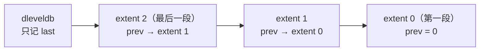

# 大文件跨 block 存放

| | |
| --- | --- |
| 读者 | 需要确认大对象如何落盘、索引里记什么的人 |
| 本文回答 | 超过当前块剩余空间的对象如何分段，以及 Range 读到哪一层 |

默认一块 **1 GiB**（`S3DFS_BLOCK_SIZE`）。能放进当前块剩余空间的对象，仍写成一条普通 TLV 记录，dleveldb 里只记这一处稳定的 `recId`。

对象放不进当前剩余空间，或本身大于一块时，按当前块还剩多少来切段：先把当前块填满，再写下一块，最后一段不必占满整块，后面的小对象可以继续追加。

## 索引：从前向后串起来

不把完整的 extent 列表写进索引，只在各段记录的 TLV tag 里保存链接：

- 后一段记录里带上前一段的 `recId`，第一段没有 prev。
- 索引只保存**最后一段**的数据位置，以及对象总长度、CRC、generation、段数。这些字段也写在最后一段的 TLV 里，扫描 block 即可重建。
- 读取时从最后一段沿着 prev 走到第一段，再**从前向后**把数据拼起来。

这样追加写时不必回头改已经落盘的记录（写后一段时前一段的 `recId` 已经知道），compact 重写文件时链条也不必改，索引体积也不随段数增长。

举例：当前块还剩 200MB，对象 2.3GB，默认块大小 1GB，大约会切成四段：200MB + 1GB + 1GB + 约 100MB（各段还要扣掉记录头尾和链接字段）。

## 记录格式

多段对象的每条记录是同样的 TLV 帧，`kind` 为中间段或最后一段。链接信息（前一段 `recId`、序号、generation、对象总长度、段数）作为 tag 写在记录里。最后一段的 CRC tag 是整个对象（key + 全部 value）的 CRC。不完整的帧不会被当成有效记录。

## 可见性

所有段写完（并随 flush / fsync 落盘）后，控制面把 last 的数据位置写入 dleveldb，对象才对外可见。扫描重建时也只把普通对象和最后一段收进索引；中间段只作为链条上的一环。如果一次跨块写入在提交索引前崩溃，块文件末尾的不完整帧会被丢掉，不会变成可见对象。

覆盖写入会生成新的 generation 和新的链条，索引改为指向新的 last（新的 `recId`）。删除会在各副本的 block 上追加墓碑，删掉对应的索引 key，并出清理票。空闲或手动 compact 会保留原来的 `recId` 重写还活着的段，回收空洞，不必改索引。说明见 [删除空洞与 compact（虚拟记录 ID）](design-compaction.md)。

## 尚待下一步

超过 1 MiB 的原始 Put 按最多 1 MiB 一块进入 block，API 不保留整段。不超过 1 MiB 的仍在 API 里压缩后一次写入。`aws-chunked` 仍先收齐再解码。分片完成时仍在 API 里拼成一个对象再写入。未压缩 Range 按偏移读取；压缩对象先整段解开。引擎的 `s3dfs_write` 可以按块追加，普通 `s3dfs_put` 仍是 `uint32`。
