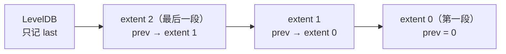

# 大文件跨 block 存放

默认一块 **1GB**（`S3DFS_BLOCK_SIZE`，`1024 * 1024 * 1024`）。能放进当前块剩余空间的对象，仍写成一条普通记录，LevelDB 里只记这一处 `(block_id, offset, size)`。

对象放不进当前剩余空间，或本身大于一块时，按当前块还剩多少来切段：先把当前块填满，再写下一块，最后一段不必占满整块，后面的小对象可以继续追加。

## 索引：从前向后串起来

不把完整的 extent 列表写进 LevelDB，只在各段记录里保存链接：

- 后一段记录里带上前一段的位置：`(prev_block_id, prev_offset, prev_rec_len)`，第一段的 prev 为 0。
- LevelDB 只保存**最后一段**的位置，以及对象总长度、CRC、generation、段数。
- 读取时从最后一段沿着 prev 走到第一段，再**从前向后**把数据拼起来。

这样追加写时不必回头改已经落盘的记录（写后一段时前一段的位置已经知道），索引体积也不随段数增长。

举例：当前块还剩 200MB，对象 2.3GB，默认块大小 1GB，大约会切成四段：200MB + 1GB + 1GB + 约 100MB（各段还要扣掉记录头尾和链接字段）。

## 记录格式

多段对象的每条记录在普通 header 之后、key 之前，多一个链接头，并带标志 `S3DFS_FLAG_EXTENT`。最后一段再加 `S3DFS_FLAG_LAST`。

链接头里有：prev 位置、序号、generation、对象总长度、段数。最后一段的 header CRC 是整个对象（key + 全部 value）的 CRC。

单段对象保持原来的 32 字节 v1 索引，老数据仍然能读。多段对象用 v2 索引（魔数 `S3X2`），只存 last。

## 可见性

写的过程中先不把对象提交到 LevelDB。所有段写完（并随 flush / fsync 落盘）后，再把 last 写入索引，对象才对外可见。回放时也只在看到带 `LAST` 的段时才安装索引；中间段只作为链条上的一环。如果一次跨块写入在提交索引前崩溃，会多扫比已提交 `wr_block_id` 更新的 block 文件，以免最后一段落在新文件里却没被回放。不完整的链条不会变成可见对象。

覆盖写入会生成新的 generation 和新的链条，LevelDB 改为指向新的 last。删除仍写墓碑并去掉索引项。Compaction 会顺着链条把完整对象读出来，再按同样的规则重写成新的 block（大对象仍可能跨块），然后删除旧文件。

## 尚待下一步

S3 API 目前仍在 Node 里缓冲完整请求体，超大上传可能在进入引擎前就占满内存。流式 Put/Get 和 S3 分片上传下一步再做。对象长度在引擎对外 API 里仍是 `uint32`，单对象上限大约 4GB − 1。
